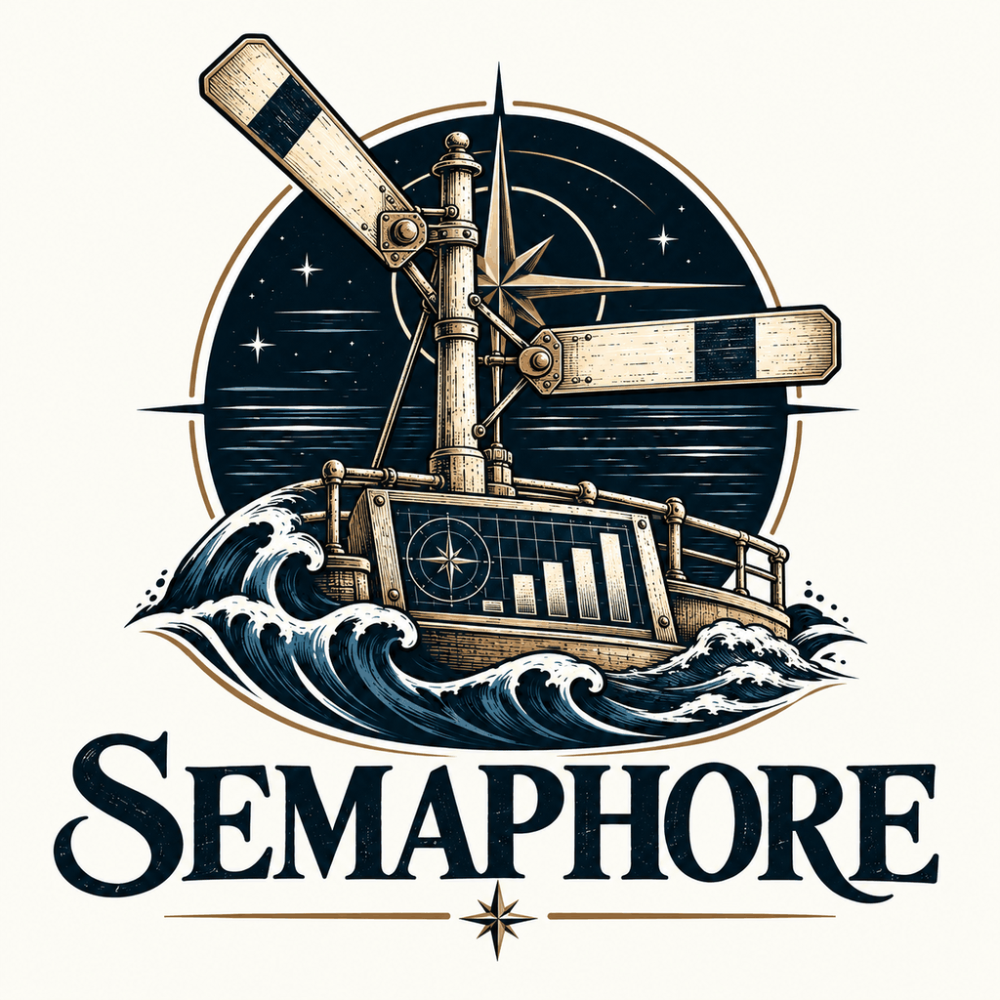

<p align="center">
  <picture>
    <source media="(prefers-color-scheme: dark)" srcset="assets/brand/emblem-dark.png">
    
  </picture>
</p>

# Semaphore · Dashboard Intelligence

Semaphore is being built as a local-first analytics and dashboard tool: an analyst describes what a chart should show, reviews the proposed data binding, and assembles a dashboard. A chart or control is a **flag**; a dashboard is a **hoist**. It is intended for Windows thin clients and Qlik-style analytical workflows.

**The default branch currently contains the v0.1.0 TypeScript core.** It is a developer library, with synthetic examples and automated tests. There is no browser application, Windows launcher, running server or live database connector on this branch yet.

The runnable application is in the open development PRs below. Their features are not part of a default-branch checkout until those PRs merge.

## Repository and application status

| Code line | What it contains | Status |
| --- | --- | --- |
| `main` | Catalog and dashboard models, layout, planning, SQL generation, cached-result filtering and draft-provider contracts | v0.1.0 core available here |
| [PR #10](https://github.com/fleethacker-data-crucible/Semaphore/pull/10) · `armp/semaphore-0.3.0` | v0.3 dashboard UI, Windows PowerShell server and launchers, sample/CSV workflows, database adapter code, analyst playbooks and leadership snapshots | Open engineering preview |
| [PR #13](https://github.com/fleethacker-data-crucible/Semaphore/pull/13) · `feature/fairlead-intelligence` | Builds on #10: Fairlead-assisted drafting, data cleaning and Qlik assistance, joins, drill-down, SQL desk, lake queries and report sharing | Open; stacked on #10 |
| [PR #11](https://github.com/fleethacker-data-crucible/Semaphore/pull/11) | Shared Fleet Gate caller and MIT license file | Open |

Use the README on the branch you check out for that branch's build and launch instructions. The architecture and roadmap also describe planned application behavior; they do not mean those components already exist on `main`.

## What the core does today

| Component | Implemented behavior |
| --- | --- |
| [Catalog](src/core/catalog.ts) | Defines sources, fields, metrics, types and synonyms; checks references and identifiers |
| [Hoists and flags](src/core/hoist.ts) | Models dashboard state and validates imported content and draft output |
| [Layout](src/core/layout.ts) | Finds slots, snaps to the grid and repairs overlapping layouts |
| [Query planner](src/core/planner.ts) | Plans aggregation, row caps and pre-sliced results for filtering on thin clients |
| [SQL generation](src/core/sql.ts) | Renders parameterized SQL for Postgres, Oracle, Access, T-SQL and an ANSI dialect |
| [Cross-filtering](src/core/crossfilter.ts) | Filters and re-aggregates cached query results; identifies cases that need a fresh source query |
| [Drafting](src/core/intelligence/index.ts) | Deterministic local rules plus optional contract/OpenAI-compatible provider adapters; validates output and falls back to local rules on provider failure |

For example, the core can interpret **“Labor cost by region”** against the sample catalog, propose a chart binding, and generate its query plan and SQL. It does not connect to that database or render the chart on this branch. Support for a SQL dialect is not evidence that a particular database driver or deployment has been tested.

The current core uses one source and one table per flag. The broader application work, including joins, is in the development PRs.

## Develop and verify the core

Use **Node.js 22.18 or later**, as specified in [package.json](package.json). Node runs the TypeScript tests directly; the test command needs no package installation.

```shell
npm test
```

For strict TypeScript checking, install the development dependencies on your development machine:

```shell
npm install
npm run typecheck
```

`main` does not currently contain a lockfile, a `build` script or `Launch-Semaphore.bat`. Follow the v0.3 branch README if you want to build and run the preview application.

## Data and AI boundaries

The core works with data supplied by its caller. Its local rules need no model or network. Remote provider adapters are optional; when used, they send drafting briefs and the summarized catalog defined by the provider contract. Drafts remain suggestions and pass validation before they are applied. SQL is generated locally with bound parameters.

This branch supplies no server-side credential storage, database execution service or deployed security boundary. The application PRs add those components and require their own deployment and security review.

Part of the Data Crucible family; the target stack and constraints are recorded in [TechStack](TechStack).

## The name

Before radio, ships talked with flags. *Semaphore* is a sailor spelling out a message with a flag in each hand, read by eye across open water. A *hoist* is the set of signal flags run up together to send one message; each flag carries one part of it. Semaphore works the same way: every flag on the dashboard carries one part of the picture, and the hoist as a whole tells leadership what they need to know at a glance.

## Documentation and examples

- [Architecture](docs/ARCHITECTURE.md): implemented core and target application design
- [Flag specification](docs/FLAG_SPEC.md): catalog, hoist and flag formats
- [Intelligence providers](docs/INTELLIGENCE_PROVIDERS.md): local rules, provider contract and validation
- [Roadmap](docs/ROADMAP.md): planned application work
- [Synthetic fleet-maintenance example](examples/fleet-maintenance/): sample catalog and hoist

## License status

This branch does not yet include a `LICENSE` file. [PR #11](https://github.com/fleethacker-data-crucible/Semaphore/pull/11) adds the organization's MIT license; the application development branch also includes it.
