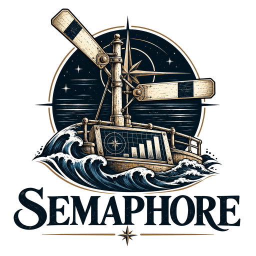
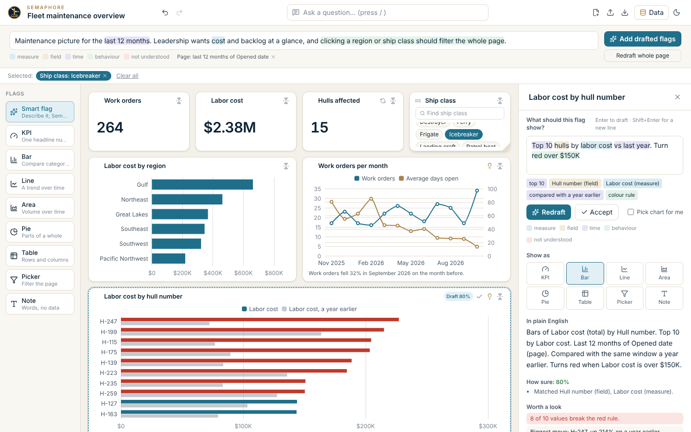
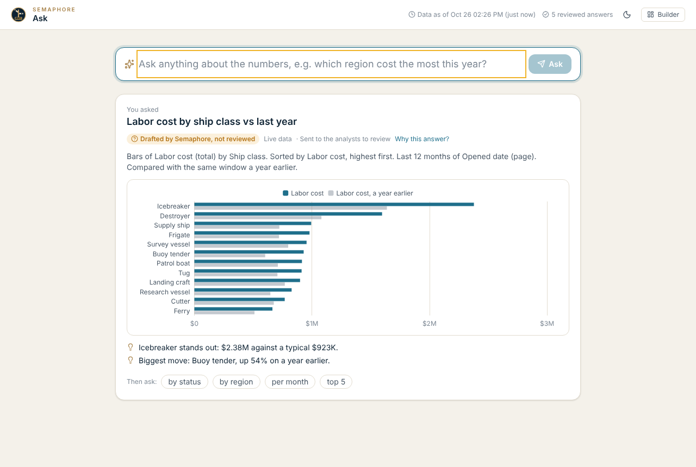
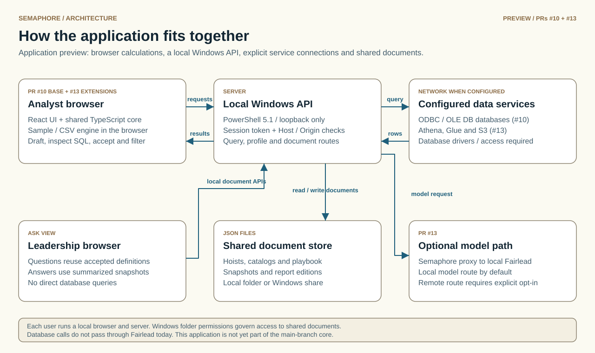

<p align="center">
  <picture>
    <source media="(prefers-color-scheme: dark)" srcset="assets/brand/emblem-dark-transparent.png">
    
  </picture>
</p>

# SEMAPHORE · Dashboard Intelligence

**Download Semaphore:** get `Semaphore-<version>.zip` (prebuilt, ready to run) from the [latest release](https://github.com/fleethacker-data-crucible/Semaphore/releases/latest), not "Source code (zip)". Unblock it, Extract All, then double-click `Launch-Semaphore.bat`.

**Reading offline?** The [standalone README](docs/README-standalone.html) and [illustrated analyst guide](docs/semaphore-for-analysts.html) embed their images. Use the file page's **Download raw file** button and open the HTML in your browser. Downloading `README.md` alone requires its image folders; both standalone guides describe this engineering preview.

Semaphore is an analyst workbench for building dashboards from plain-English briefs, CSV files and configured database sources. Analysts review each proposed chart and its SQL, accept useful work into a shared playbook, and publish summarized snapshots that leadership can question without opening a database. It targets Windows thin clients and Qlik-style analytical workflows.

> **Engineering preview (0.3 development line).** This README describes the reconciled application in [PR #17](https://github.com/fleethacker-data-crucible/Semaphore/pull/17). It incorporates PR #10, the feature work formerly reviewed in PR #13, and the CI, license and documentation changes from PRs #11 and #18. Sample and CSV workflows are available here; database adapters and the Athena integration need validation against the intended services and target workstations.

Part of the Data Crucible family alongside Lazarette, Halyard and Shellback, and built on the same [TechStack](TechStack).

## The name

Before radio, ships talked with flags. *Semaphore* is a sailor spelling out a message with a flag in each hand, read by eye across open water. A *hoist* is the set of signal flags run up together to send one message; each flag carries one part of it. Semaphore works the same way: every flag on the dashboard carries one part of the picture, and the hoist as a whole tells leadership what they need to know at a glance.

<p align="center">
  <picture>
    <source media="(prefers-color-scheme: dark)" srcset="docs/screenshot-dark.png">
    
  </picture>
</p>

## Analysts build, leadership asks

Semaphore serves two people. **Analysts** build: they describe flags, check Semaphore's drafts and accept them. **Leadership** asks: they want an answer they can trust, not a dashboard tool.

Every flag an analyst accepts pairs a plain-English question with the exact data behind its answer. The **playbook** collects those reviewed pairs, so leadership gets a single question box answered from the analysts' own work, each answer labelled *reviewed*, *drafted, not reviewed* or *can't answer yet*. When an analyst is out, Semaphore stands in: it answers familiar questions, briefs leadership on what changed, and queues anything new for the analyst's return. Its playbook reuses accepted definitions and snapshots; it does not train a model on user activity. Leaders never connect to a database: they are answered from small, already-summarised snapshots of the analysts' accepted flags, each showing how fresh it is.

<p align="center">
  <picture>
    <source media="(prefers-color-scheme: dark)" srcset="docs/screenshot-ask-dark.png">
    
  </picture>
</p>

Leadership opens it with **`Ask-Semaphore.bat`**. How it works and what is still to come: [docs/PLAYBOOK.md](docs/PLAYBOOK.md).

## Run it

**Just want to run it?** Download `Semaphore-<version>.zip` from the [latest prebuilt release](https://github.com/fleethacker-data-crucible/Semaphore/releases/latest) (not "Source code (zip)", which has no built UI). Right-click the zip, choose Properties and Unblock if shown, then Extract All and double-click **`Launch-Semaphore.bat`**. Nothing to install or build. A clone of this repo does not run until it is built (steps below), because `web\dist` is not in git. If the zip will not extract, or Semaphore does not open, double-click [`tools\env-check\Check-Environment.bat`](tools/env-check): it tests that workstation (zip handling, launch, loopback ports, browser) and writes a log you can compare between machines.

To build it yourself:

1. On a build machine, run `npm ci` then `npm run build` once. This writes the page to `web\dist` (the workstation never builds anything).
2. Copy the folder to the workstation and double-click **`Launch-Semaphore.bat`**. It needs Windows PowerShell 5.1 and Edge or Chrome. The built sample/CSV application runs offline without Node.js, admin rights or runtime installation. Configured databases, AWS services, a shared network folder or a remote AI route require the corresponding network access.
3. Semaphore opens on the fleet-maintenance example with generated sample data. Click **New hoist** for an empty page, or **Data** to add CSV files or a database.
4. Leadership double-clicks **`Ask-Semaphore.bat`** instead: a question box answered from the analysts' reviewed work, with no database access needed. Share the playbook by pointing `SEMAPHORE_HOME` at one network folder on every computer.
5. To stop, choose **End session**, or close the tab: the server stops itself about 5 seconds later (or 90 seconds after the last sign of life if the browser could not say goodbye). `server\Stop-Semaphore.ps1` stops any copy that is still running.

> **Current connections:** optional model requests go through the local [Fairlead](https://github.com/fleethacker-data-crucible/Fairlead) proxy. Database and Athena requests currently use Semaphore's own connectors and settings. Routing data sources through Fairlead is a direction in [TechStack](TechStack), not the implementation today.

**AI drafting (optional).** Local rules draft every flag with no model. AI provider keys live in Lazarette and reach only Fairlead; Semaphore only ever holds a client token that Fairlead issues to it. To draft with a model, install a key for **Semaphore** in **Fairlead > Clients** (Fairlead stores it in Windows Credential Manager as `Fairlead/Semaphore`), or as a manual fallback create a client key there, then double-click **`Set-SemaphoreAiKey.bat`** and paste it (only `fl-…` tokens are accepted, never a provider key) (it stores the key under the same name); `SEMAPHORE_AI_KEY` overrides the stored key. Legacy DPAPI files remain readable for compatibility. The Fairlead key never reaches the page. Drafts then go through Fairlead's `local` route, so prompts stay on this computer; **Settings > AI drafting** shows the state and switches it off. If Fairlead is down or refuses the key, local rules draft instead and say why. See [docs/INTELLIGENCE_PROVIDERS.md](docs/INTELLIGENCE_PROVIDERS.md).

Launcher options: `--ask` (the leadership view; `Ask-Semaphore.bat`), `--refresh` (refresh every playbook snapshot headless and stop; for an IT-approved morning run, see [docs/PLAYBOOK.md](docs/PLAYBOOK.md)), `--no-browser`, `--stay` (keep running after the tab closes), `--replace` (stop a running copy and start fresh), `--console`, `--check-only` (self-check, no server), `-Port <n>` (or `--port <n>`). Semaphore's block is loopback ports 8800–8802 (Fleet port registry), clear of Eight Bells, Scrimshaw and Fairlead (8774–8776); it asks Fairlead for AI on 127.0.0.1:8776. Set `SEMAPHORE_AUTO_STOP=0` to turn auto-stop off. Scheduled report editions and snapshot refreshes need an active instance or an explicitly scheduled `--refresh` run; the launcher does not install an automatic background service or task.

## Architecture at a glance

<picture>
  <source media="(prefers-color-scheme: dark)" srcset="docs/diagrams/application-overview-dark.svg">
  
</picture>

[Architecture diagrams](docs/ARCHITECTURE-DIAGRAMS.md): current core, preview application, and AI payload / credential boundaries, with editable SVGs and Mermaid flows.

## What it does

| | |
| --- | --- |
| **Brief boxes that read back** | As you type, measures, fields, time, ranking and behaviour are highlighted. Unknown words are underlined; typos get "did you mean", and picking one teaches the catalog the word. |
| **Smart flags** | Describe a flag and Semaphore picks the chart from the data's shape: one number is a KPI, time is a line, parts of a whole are a pie, a long list is cut to its top 15. |
| **Questions** | "Which ship class had the most work orders?" comes back as a chart you can pin. |
| **Comparisons and shares** | "vs last year", "compared with the previous quarter", "as a % of total", like for like. |
| **Starter page** | An empty page offers one drafted from the catalog: headline numbers, pickers, a trend, a breakdown and a top 10. |
| **Worth a look** | Each flag points out the latest move in a trend, a dominant category, an outlier, the biggest change and values breaking a red rule. |
| **Flip a flag over** | The flag in plain English, why Semaphore drafted it that way, and the exact SQL with its parameters. |
| **Cross-filtering** | Click a bar or a picker value and the whole page filters from cached results, asking the source again only when it must. |
| **Lego grid** | Drag, resize, drop from the palette, arrow keys, undo and redo. Light and dark themes. |
| **Catalog from your data** | Add a CSV file or profile a database table and Semaphore proposes measures and fields, with labels and synonyms from the column names, for you to check. Large CSV files are read in a Web Worker. |
| **Joins and drill paths** | Relationships let a flag on one table group or filter by another (Data > Links finds them for you). Flags set to drill go year → quarter → month → day, or along a drill path, down to the rows. |
| **Messy data, cleaned with you** | Data > Clean finds stray spaces, the same label spelt different ways, numbers kept as text, mixed date formats, blanks and duplicate rows, and offers each fix as a sentence to accept or undo. The data itself is never changed. |
| **Import from Qlik** | Paste a load script and chart expressions: tables, Qlik's field names, measures, mapping loads (as cleaning) and associations (as joins) come across for you to check. |
| **SQL desk** | Write your own SELECT against a source on this computer, the lake included, under the same guard and cost guard. |
| **Regular reports and briefings** | A page you open every Monday keeps coming while you are away, for leadership to read; "Brief me" says what a page shows in a few sentences, each linked to its flag. |
| **Page design and exports** | Restyle a page or one flag: palettes, gradients, glow, gauges, funnels, target lines, zoom and motion. Export to PDF, Excel with native charts, PowerPoint, Word, HTML, CSV or JSON. See [docs/DESIGN.md](docs/DESIGN.md). |
| **Flag kits** | Save a set of flags as a kit and fly it on another catalog: each metric and field is matched by key, then label, then synonym, and anything that does not match arrives as an empty draft with a reason ([docs/FLAG_KITS.md](docs/FLAG_KITS.md)). |
| **Comparisons that follow a drill** | A flag set to compare keeps its comparison as you drill (2026 Q3 against 2025 Q3), and shared reports carry the earlier window too ([docs/DRILL_COMPARISONS.md](docs/DRILL_COMPARISONS.md)). |
| **One-to-many joins** | Split or filter a measure on the "one" side by a field on the "many" side without double counting; overlapping groups are flagged and given no grand total ([docs/ONE_TO_MANY_JOINS.md](docs/ONE_TO_MANY_JOINS.md)). |
| **Lineage and sharing** | See which flags read which measures, fields and tables. Share a page as one HTML file that keeps its filters, optionally locked with a passphrase. |

Everything above runs with no AI model. With Fairlead the AI drafts flags and pages, suggests cleaning, reads hard Qlik expressions and writes briefings; Semaphore checks every answer before using it ([docs/INTELLIGENCE_PROVIDERS.md](docs/INTELLIGENCE_PROVIDERS.md)). Optionally (off by default, per browser) a few reviewed playbook entries go along as worked examples, with briefs and catalog names only. A Databricks serving-endpoint provider exists but has only been tested against a simulated endpoint ([docs/DATABRICKS.md](docs/DATABRICKS.md)).

## Databases

List them in `sources.json` in your Semaphore folder (`%USERPROFILE%\Semaphore`, or `SEMAPHORE_HOME`):

```json
[
  { "id": "maint", "label": "Maintenance warehouse", "kind": "postgres", "provider": "odbc", "connection": "DSN=MaintWarehouse" },
  { "id": "parts", "label": "Parts tracker", "kind": "access", "provider": "oledb", "connection": "Provider=Microsoft.ACE.OLEDB.12.0;Data Source=\\\\server\\share\\parts.accdb" }
]
```

Semaphore uses .NET Framework's ODBC and OLE DB APIs. The appropriate database driver/provider, matching the PowerShell process architecture, must already be installed; Semaphore does not install it. Then open **Data**, pick the table and choose **Profile and add**.

**Passwords from Lazarette.** A connection string never holds a password (one with `PWD=` is refused). Use a DSN, Windows authentication, or Lazarette: pair once (Lazarette > Settings > Tools > Pair tool, then paste the code in Semaphore under Settings > Lazarette), share the item with Semaphore under a variable name, and name it in the source:

```json
{ "id": "maint", "kind": "postgres", "provider": "odbc", "connection": "Driver={PostgreSQL Unicode};Server=db;Database=maint",
  "vault": { "password": "SMDATS_PASSWORD", "user": "SMDATS_USER" } }
```

Semaphore reads the shared names from the running, unlocked Lazarette over loopback for each query; it never loads Lazarette's engine or holds the vault key. If Lazarette is stopped, locked, not paired or a name is not shared, the flag says so in a sentence. See [docs/VAULT.md](docs/VAULT.md).

**More connectors.** `redshift-data` (Amazon Redshift Data API), `synapse` (Azure Synapse and Azure SQL through ODBC Driver 17/18 with Entra sign-in) and `foundry` (Palantir Foundry SQL). Examples, limits and what has and has not been validated against real services are in [docs/CONNECTORS.md](docs/CONNECTORS.md).

> **What has been tested for real.** ODBC and OLE DB run through the real Microsoft Access Text and ACE drivers in the Pester suite (binding, types, errors), but not against a Postgres, Oracle, SQL Server or Access `.accdb` server. Athena, Redshift and Foundry are tested against simulated services only. Real-service checks are listed for Anthony in [docs/CONNECTORS.md](docs/CONNECTORS.md) and [docs/VAULT.md](docs/VAULT.md).

**The S3 data lake (Athena).** A lake source needs no driver: Semaphore signs its own requests to Athena, Glue and S3.

```json
{ "id": "lake", "label": "Data lake", "kind": "aws-athena", "provider": "athena", "region": "us-gov-west-1",
  "workgroup": "semaphore", "database": "maintenance", "priceUsdPerTB": 5, "approveAboveGB": 10, "dailyLimitGB": 200, "cacheHours": 12 }
```

- **Cost guard:** before a flag's query runs, Semaphore estimates the table size on S3 and the potential scan cost; above `approveAboveGB` the flag asks before running, a partitioned table queried without a partition filter is warned about, and `dailyLimitGB` caps each analyst's scans per day. What Athena actually read is recorded per query. These are application estimates and controls, not a guarantee of the final AWS bill.
- **Result cache:** the same query within `cacheHours` is answered from `<home>\lakecache`, free.
- **Adding a lake table** reads the Glue catalog only: no scan, no cost.
- **AWS keys never go in sources.json** (they are refused). Semaphore uses a session shared from Lazarette (`"vault": { "accessKeyId": "AWS_ACCESS_KEY_ID", "secretAccessKey": "AWS_SECRET_ACCESS_KEY", "sessionToken": "AWS_SESSION_TOKEN" }`), or else a short session from the environment that starts it (`AWS_ACCESS_KEY_ID`, `AWS_SECRET_ACCESS_KEY`, `AWS_SESSION_TOKEN`).

The lake engine and the SQL desk are implemented on this development branch. Live AWS access needs valid session credentials, service permissions and a configured Athena workgroup; it is not part of the offline sample demo.

## Privacy and security in short

- The server listens on loopback only, checks every request's `Host` and `Origin`, and needs a per-session token. The launcher hands the browser a single-use launch code (valid 10 minutes) that the page trades for the token, so the token never appears on a command line, in a console transcript, on disk or in a log.
- The page runs under a strict content security policy (no inline script, no inline style sheets, no outside addresses), `Cross-Origin-Opener-Policy: same-origin`, and a `Permissions-Policy` that turns off camera, microphone, location, USB, serial and HID. The page's own script errors go to the server log (message, stack and view only, never data values).
- CSV files are parsed in the browser. Database/lake queries connect to their configured services. Shared playbooks, frozen report editions and exported HTML can contain result data; treat them as data-bearing files.
- AI payloads depend on the feature: drafting sends briefs and summarized catalog metadata; cleaning assistance sends up to 300 distinct values with counts; Qlik assistance sends the selected expression and field metadata; briefings send computed facts and chart titles. These are not full-table uploads, but can still contain business data. Fairlead's `local` route and privacy header are the default; explicitly changing the route/privacy settings can permit remote model processing.
- No passwords in connection strings: use a DSN, Windows authentication, or a password shared from Lazarette. SQL is generated by Semaphore with bound, typed parameters, and the server refuses anything but a single `SELECT`.
- Hoists and the catalog are JSON files in your Semaphore folder. Saves are atomic, and a save over a copy someone else changed since you opened it is refused instead of overwriting their work.
- The Fairlead key goes only to the process that really holds Fairlead's port (its PID is checked), never to a program that merely claims to be Fairlead.

## Build and test

Node 22.18 or later. `npm ci` installs the build tools (esbuild, Tailwind, React, ECharts); they are bundled into `web\dist` and never needed on the workstation.

```shell
npm test             # node --test: core, data path and UI logic
npm run typecheck    # strict tsc for the core and the UI
npm run build        # web/dist, then the CSP build contract (no inline script or style)
npm run size         # size report; fails when the initial JS is over web/size-budget.json
npm run e2e          # Playwright against tests/e2e/mock-server.mjs (needs npm run build first)
npm run dev          # rebuild on change
```

Server tests are Pester 5 (`Invoke-Pester tests\server`) under Windows PowerShell 5.1. The end-to-end suite uses Playwright's Chromium locally and the installed Edge in CI (`SEMAPHORE_E2E_BROWSER_CHANNEL=msedge`); CI runs on GitHub-hosted Windows runners (see the note at the top of `.github/workflows/ci.yml`).

## Documentation

- [docs/UNIFIED-UI.md](docs/UNIFIED-UI.md): the Fleet Unified UI requirements Semaphore follows (an unchanged copy; see [docs/SKINS.md](docs/SKINS.md) for how Semaphore applies them)
- [docs/DEMO-WALKTHROUGH.md](docs/DEMO-WALKTHROUGH.md): a shot-by-shot script for a five-minute demo video on the synthetic example
- [docs/VAULT.md](docs/VAULT.md): the Lazarette bridge for database secrets and AWS sessions
- [docs/CONNECTORS.md](docs/CONNECTORS.md): Redshift, Synapse, Foundry, and how each connector is tested
- [docs/CLI.md](docs/CLI.md): `Semaphore-CLI.bat`, every headless action as `<noun> <verb>` with `--json`, `--out`, `--yes` and `--dry-run`
- [SQL languages and compatibility](docs/SQL-LANGUAGES.md): the full dialect name under a flipped card, syntax and parameter explanations, and the implemented profiles and their limits.
- [Illustrated analyst guide](docs/semaphore-for-analysts.html): seven actual screenshots with workflow captions. Its images are embedded, so only the HTML file is needed.
- [Semaphore, Qlik and Data Noodler comparison (PDF)](docs/Semaphore-Qlik-DataNoodler-Comparison.pdf): capability tables, architecture and the screenshot walkthrough.
- [docs/PLAYBOOK.md](docs/PLAYBOOK.md): learning from analysts, the leadership view, snapshots, standing in for an absent analyst
- [docs/ARCHITECTURE.md](docs/ARCHITECTURE.md): layers, the thin-client data strategy, storage, and how the TechStack maps on
- [docs/FLAG_SPEC.md](docs/FLAG_SPEC.md): the catalog, hoist and flag formats
- [docs/INTELLIGENCE_PROVIDERS.md](docs/INTELLIGENCE_PROVIDERS.md): what local rules understand, AI providers, and the contract
- [docs/ROADMAP.md](docs/ROADMAP.md) and [CHANGELOG.md](CHANGELOG.md)
- [examples/fleet-maintenance/](examples/fleet-maintenance/): the sample catalog and hoist (synthetic)

## License

MIT. See [LICENSE](LICENSE).
