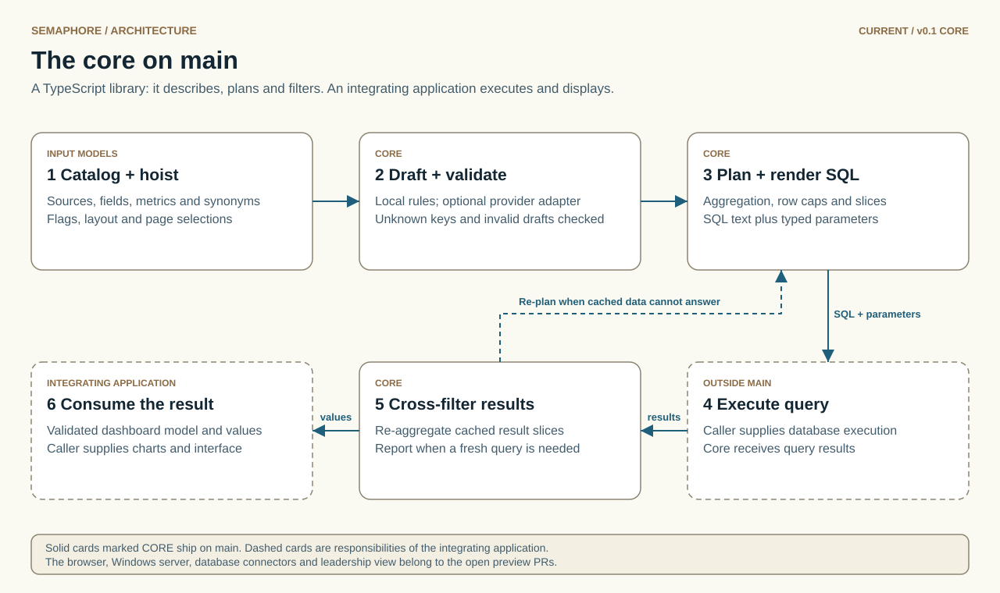
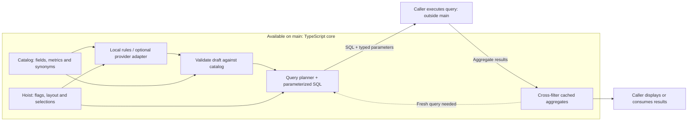
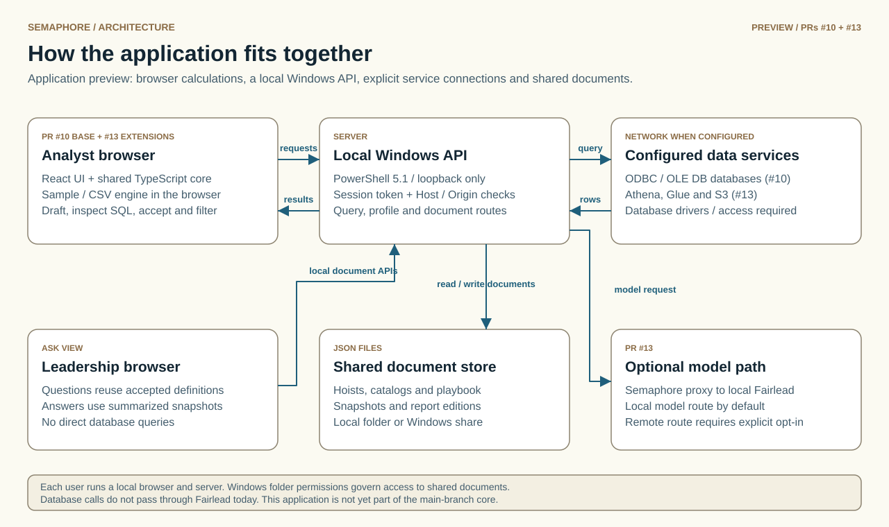
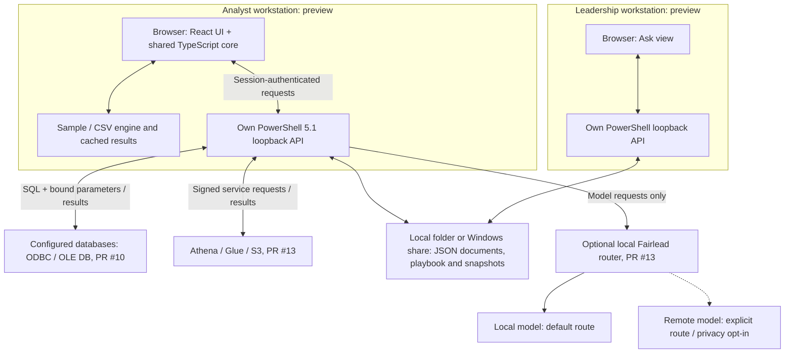
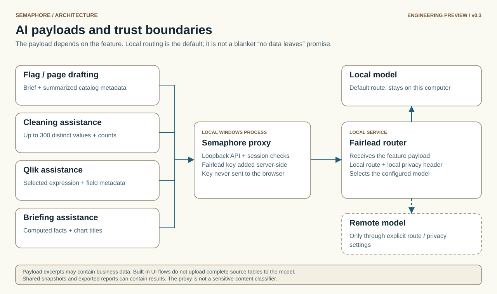
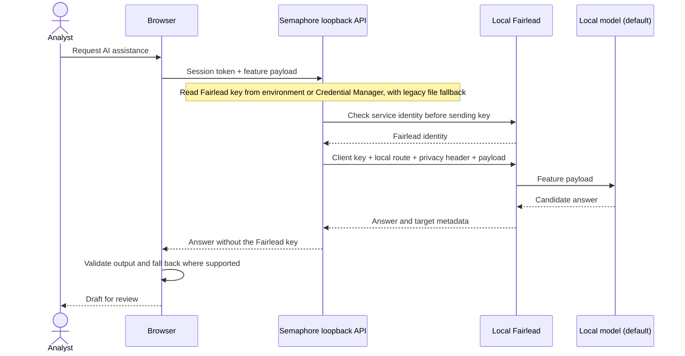

# Semaphore architecture, visually

These diagrams distinguish the **v0.1 core on `main`** from the **application previews in PR #10 and PR #13**. A component shown in a preview is not a claim that it exists in a default-branch checkout. Diagram assets are repository-local SVGs with light/dark variants and descriptive text.

## 1. Current core: available on main

<picture>
  <source media="(prefers-color-scheme: dark)" srcset="diagrams/core-overview-dark.svg">
  
</picture>

The core supplies models, local-rule drafting, optional provider adapters, validation, layout, planning, parameterized SQL and cached-result filtering. The integrating application supplies query execution and presentation.

SQL-dialect support is not a live database connector. A draft is not an accepted analytical answer. Optional remote-provider adapters can make configured model requests; local rules do not require a model or network.

## 2. Application preview: components and data paths

<picture>
  <source media="(prefers-color-scheme: dark)" srcset="diagrams/application-overview-dark.svg">
  
</picture>

**PR #10** provides the browser/server application, sample/CSV workflows, ODBC/OLE DB adapter code, playbooks and leadership snapshots. **PR #13**, stacked on #10, adds the Fairlead integration, Athena/lake path and additional analytical features. Real services and target-machine deployment require their own validation.

- Each user runs a local browser and server. The normal leadership UI reads snapshots rather than querying database sources.
- Windows folder permissions determine access to shared JSON files; the two views are not a substitute for file-access controls.
- Database/lake connections currently bypass Fairlead. The router handles optional model requests, not database traffic.
- Sample/CSV analysis can run offline. Databases, AWS services, shared folders and explicitly remote model routes need their corresponding network access.
- Report editions and snapshot refreshes require a running instance or an explicitly scheduled refresh. Closing the browser normally stops its server; the app does not install an always-on service.

## 3. AI requests: payloads and credential boundary

<picture>
  <source media="(prefers-color-scheme: dark)" srcset="diagrams/ai-boundaries-dark.svg">
  
</picture>

This flow describes **PR #13**. The exact payload depends on the feature, and excerpts can contain business data. The built-in UI does not upload complete source tables to the model. The proxy is not a sensitive-content classifier. Shared snapshots and exported reports are separate data-bearing files.

An explicitly configured nonlocal route and privacy override can permit remote model processing. The default local path shown above does not promise that every possible configuration is offline.

## Source map

| Diagram area | Code to inspect |
| --- | --- |
| Current core | `src/core/catalog.ts`, `hoist.ts`, `layout.ts`, `planner.ts`, `sql.ts`, `crossfilter.ts`, `intelligence/` on `main` |
| Preview UI and data execution | `web/src/lib/data.ts`, `worker.ts`, `playbook.ts`, and `web/src/components/AskView.tsx` on the application branches |
| Loopback server and document/query APIs | `server/Start-Semaphore.ps1`, `Http.ps1`, `Routes.ps1`, `Query.ps1` on the application branches |
| Lake services | `server/Lake.ps1` in PR #13 |
| AI routing and credentials | `web/src/lib/ai.ts`, `server/Intelligence.ps1`, `AiCredential.ps1` and `Set-SemaphoreAiKey.ps1` in PR #13 |
| AI feature payloads | `src/core/intelligence/tasks.ts` in PR #13 |
| Shared report payloads | `src/core/reports.ts`, `web/src/lib/share.ts` and `web/src/report.tsx` in PR #13 |

For the longer design narrative, see [ARCHITECTURE.md](ARCHITECTURE.md). For branch status and launch instructions, use the [README](../README.md) on your current branch.
