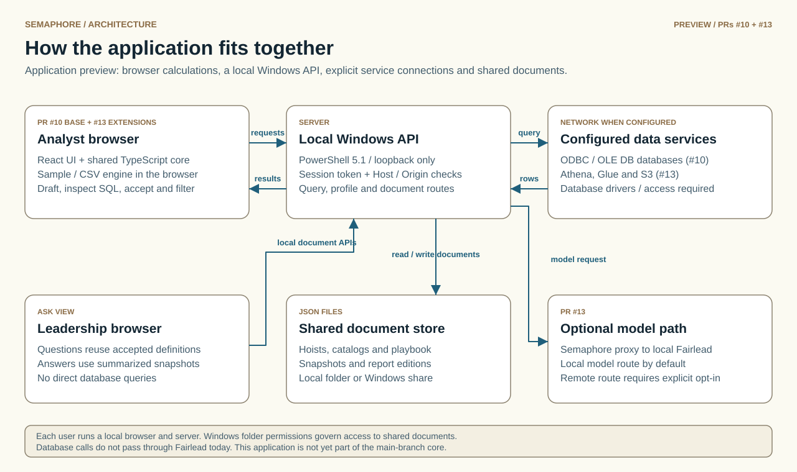

# Semaphore architecture

**Scope:** this is the reconciled v0.3 application preview in PR #17, incorporating PR #10 and the feature work from PR #13.

<picture>
  <source media="(prefers-color-scheme: dark)" srcset="diagrams/application-overview-dark.svg">
  
</picture>

See [Architecture, visually](ARCHITECTURE-DIAGRAMS.md) for the component, data-flow and AI-boundary diagrams, including explicit current-versus-preview labels.

**The stack is defined by [`TechStack`](../TechStack).** This document describes how Semaphore uses it.

## Two users, one body of knowledge

Semaphore is built for **analysts**, who build and review hoists, and **leadership**, who ask questions and need answers they can trust. The preview includes both the analyst workflow and the leadership view:

- Every accepted flag is a reviewed pair of a plain-English question and an exact binding. Bindings are catalog keys only, so they can be replayed on today's data by anyone with access to the source.
- All "intelligence" goes through one validated path (`validateFlagDraft`, `parseBinding`), whether it comes from local rules, a supported AI provider or the playbook. Nothing reaches a flag that is not checked against the catalog.
- Reading a brief (`annotateBrief`) gives a deterministic signature of a question: its measures, fields, window, ranking and behaviour. The playbook matches leadership's questions to analysts' accepted flags with that signature, so every answer can say which reviewed flag it reused.

The playbook, snapshots and the leadership view are built (0.3); [PLAYBOOK.md](PLAYBOOK.md) has how they work, the decisions behind them, and what is still to do.

## Layers

```
Launch-Semaphore.bat ──► server/Start-Semaphore.ps1   PowerShell 5.1, TcpListener on 127.0.0.1:8800-8802
                           ├─ static UI from web/dist (compiled JS/CSS only)
                           ├─ session token, Host/Origin checks, /__fleethacker/id and /shutdown
                           ├─ /api/heartbeat, /api/leaving, /api/end   lifecycle per TechStack
                           ├─ /api/hoists, /api/catalogs               JSON files in the user's Semaphore folder
                           ├─ /api/query                               rendered SQL + typed parameters → ODBC / OLE DB
                           └─ /api/profile                             tables, columns, types, distinct counts

Browser
  web/src                 React 19 UI: canvas, palette, inspector, brief editor, ask box, data panel
    lib/data.ts           runs a flag: plan → page engine or /api/query → cross-filter → comparison
  src/core                framework-free TypeScript, unit-tested, shared by the UI and the tests
    catalog.ts            semantic layer: sources, fields, metrics, defined once
    profile.ts, csv.ts    propose a catalog from a profiled table or a CSV file
    hoist.ts              hoist (dashboard) and flag (block) model + validation
    layout.ts             lego grid placement
    planner.ts            flag → query plan, sized for a thin client; comparison windows
    sql.ts                plan → SQL per dialect, typed bound parameters
    engine.ts             plan → rows, in memory (sample data and CSV files in the page)
    crossfilter.ts        page selections applied to cached results locally; totals; line-up
    shape.ts              the chart a binding's shape calls for
    describe.ts           a flag in plain English
    insights.ts           what is worth a glance in a flag's own result
    intelligence/         provider contract, local rules, brief annotation, remote providers
  src/sample              generated rows for the fleet-maintenance example

  src/core/playbook.ts    learn on accept, provenance, needs review, question → entry, trust labels
  src/core/snapshot.ts    accepted flags → aggregated, pre-split snapshots; answers by re-adding them
  web/src/components/AskView.tsx        leadership view: question box, answers, headline numbers, what changed
  web/src/components/PlaybookPanel.tsx  analysts: leadership's questions, answers in use, needs review, coverage

Server (same document store as hoists)
  /api/playbook, /api/snapshots, /api/questions   one JSON file per document in the shared Semaphore folder
```

Sample and CSV calculations run in the browser. Shared snapshots and exported reports can contain result data; optional AI payloads are described in the visual guide and the intelligence-provider document. Sources held in the page (the example's sample rows and CSV files) are answered by `engine.ts`, which runs exactly what `renderSql()` would ask a database for, so a flag behaves the same on a CSV file and on Oracle. Every other source goes to `/api/query` as SQL with bound, typed parameters; ODBC and OLE DB bind positionally, so the UI renders `?` placeholders for them (`renderSql(..., { placeholders: 'question' })`).

## Thin clients: the database does the work

For database-backed flags, the planner pushes aggregation to the source to limit result sizes. CSV imports and explicit row views are separate paths; this is not a blanket promise that the browser never holds rows.

1. **Aggregate at the source.** Every flag becomes one `GROUP BY` query. Millions of rows in Oracle come back as a few hundred.
2. **Pre-slice for the page.** A flag's query is also split by the fields *other* flags on the page can select (filter flags, and charts whose click filters the page). Clicking "Northeast" on one flag then filters every other flag from its cached result, with no round trip. Example: work orders split by 6 regions × 12 ship classes is 72 rows.
3. **Re-aggregable partials.** Results carry partials, not finished numbers: `avg` travels as `sum` + `count`, so re-adding after a filter is exact. A distinct count cannot be re-added, so a flag with one sends page selections back to the source instead, and says so.
4. **Row caps.** Each query is capped (50,000 rows by default). Slices are added cheapest first while the estimate stays under the cap; the rest become **live**: a selection on that field re-queries the source for that flag only, and the flag shows its last result until the new one arrives.
5. **Top-N.** A "top 10" is cut at the source only when nothing is re-aggregated locally and it does not rank by an average; otherwise it is cut after local filtering, so it is the right top 10 for the current selection. When it is cut at the source, selecting a value outside the top 10 re-queries the source. It is always cut locally as well, because Access's `TOP n` returns ties.
6. **Truncation.** A result as long as the row cap may be missing rows. It is marked `truncated` so the UI can show the totals as incomplete, and every selection on that flag goes to the source.

Estimates use profiled cardinalities from the catalog, `in`/`eq` filters, and relative date filters ("last 12 months" at month grain is 12).

### Associative filtering

Filter flags are pre-sliced like any other flag, so selecting a region narrows the ship-class list to classes with work in that region, the way Qlik users expect. A picker's own selection does not filter the picker, so it keeps listing every value.

### Per-flag "ignore"

A flag's brief can opt out of page selections ("ignore the region filter"). The field is then left out of that flag's plan entirely, and its selections are skipped when cross-filtering.

## SQL safety

- Table and column names come only from the catalog, are checked by `isIdentifier()` and are always quoted (`"name"`, or `[name]` for Access).
- Every value is a bound parameter (`$1` Postgres, `:p1` Oracle, `@p1` T-SQL, `?` Access/ANSI), typed by its field (`date`, `number`, `boolean`, `string`). The server binds them with the driver API as real dates and numbers. A date's upper bound covers the whole day (`< next day`).
- T-SQL needs `DATETRUNC`, so Azure SQL or SQL Server 2022 and later. The catalog check flags a source whose dialect does not match its kind.
- Date buckets and "last N" edges are computed in UTC. A Postgres `timestamptz` column truncates in the session time zone, so the server sets the session to UTC.
- Oracle quoted identifiers are case-sensitive; profiling stores names exactly as the database reports them.
- Access has no `COUNT(DISTINCT …)`; Semaphore refuses rather than generating wrong SQL.

## Untrusted input

Hoist files, imports and AI output are capped before use: briefs at 4,000 characters, 200 flags, 50 metrics, 20 fields, 50 filters of at most 500 values, 20 thresholds, 2 MB provider responses, 200 warnings. Overlapping layouts are repaired on load. Regexes that read briefs are bounded, and provider text is unwrapped without regexes.

## Current preview limits

- A flag uses one source and a base table for its measures. Grouping and filter fields can follow configured many-to-one relationships within that source.
- Cross-table filtering depends on valid catalog relationships; unrelated tables are refused. Live database and lake deployments still need target-service validation.

## Storage

- **The playbook** (accepted question-and-binding pairs, learnt vocabulary, the question queue) is JSON in `<home>\playbook\`. Sharing it between analysts and leadership happens through a Semaphore folder, which may be a Windows network share: each person runs their own loopback copy. Leadership reads **snapshots** in `<home>\snapshots\` (aggregated, pre-split results of accepted flags, refreshed when an analyst runs Semaphore) and never connects to a source; the folder's Windows permissions decide who can see them.

- **Hoists and the catalog are small JSON files**, saved by the server in the user's Semaphore folder (`%USERPROFILE%\Semaphore`, or `SEMAPHORE_HOME` / `home` in settings for a network folder on non-persistent VDI profiles). Every change autosaves.
- **Without a server** (the build opened another way) the working hoist and catalog stay in this browser's localStorage, and a hoist can be downloaded and imported as a file.
- **CSV files** are read in the page and kept in IndexedDB so they come back after a reload. They are never uploaded.
- Credentials never enter the browser or the hoist. Server sources are DSNs or integrated authentication; a connection string with a password is refused. A source may instead name Lazarette shares for its password, user or keys, read over the Lazarette tool route (docs/VAULT.md).

## Sharing

A report is exported as one self-contained HTML file (the same technique as Shellback's standalone edition): the cached results, the hoist and the cross-filter engine, with optional AES-GCM passphrase encryption. Recipients need nothing installed; live drill-downs are disabled in the export.

## TechStack mapping

| TechStack item | Semaphore use | State |
| --- | --- | --- |
| `.bat` → `powershell.exe -File` | `Launch-Semaphore.bat` → `server\Start-Semaphore.ps1` | Done |
| PowerShell 5.1 + `TcpListener` | Loopback server, query and profile endpoints, every lifecycle rule | Done |
| React 19 + TS | UI (`web/src`) | Done |
| Tailwind 4 + shadcn-style | Styling with theme tokens; Lucide icons | Done (CVA and Radix not needed yet) |
| ECharts, React Flow, Motion | Flag rendering (ECharts, SVG renderer); lineage view (Flow) | ECharts done; Flow planned |
| Rust → WebAssembly | Optional: cross-filter kernel if results grow; today's results are small enough for TypeScript | Not needed yet |
| IndexedDB / localStorage | CSV files / theme, working copy | Done |
| Service workers, Web Workers | CSV parsing and queries use a worker; app-shell service-worker caching is not implemented | CSV worker done |
| Web Crypto, Windows Credential Manager | AES-GCM report encryption and server-side Fairlead key storage; legacy DPAPI file compatibility | Implemented in this preview |
| C# via `Add-Type` | In-memory native Windows credential bridge; database access uses the framework ODBC/OLE DB APIs | Implemented; no custom DLL shipped |
