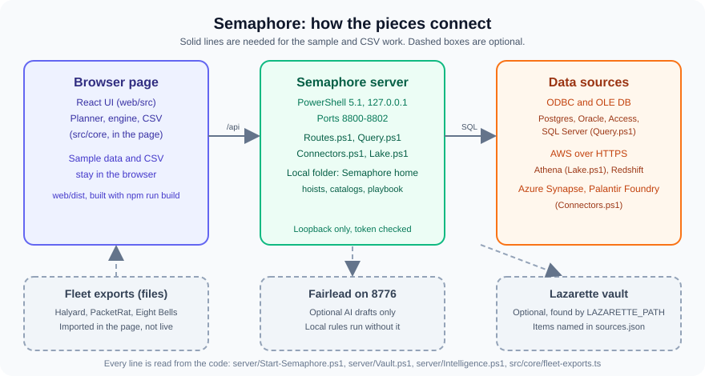
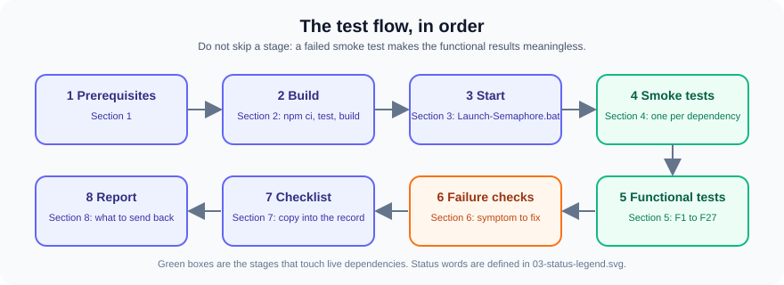
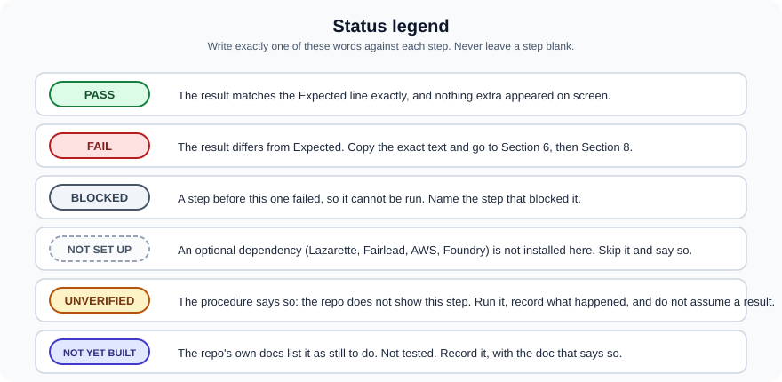
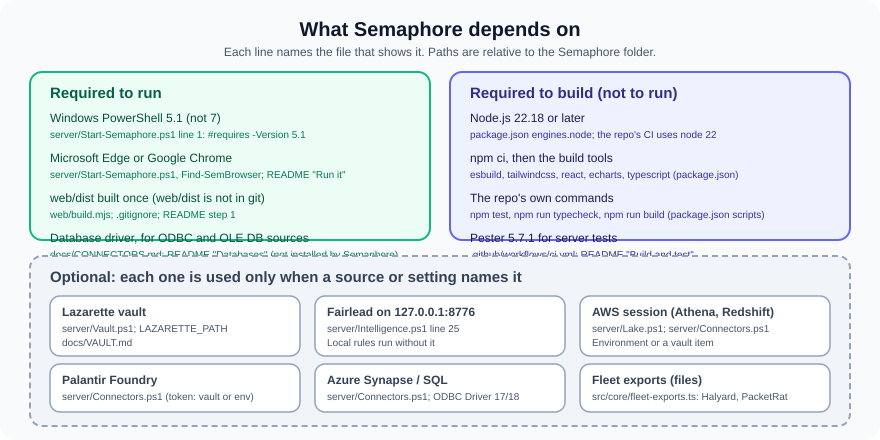

# Semaphore: Tech Test Procedure

This procedure tests Semaphore 0.3.0 (an engineering preview) on one Windows workstation. It takes a tester from a clean clone to a recorded result. Sections 1 to 4 need no database and no AWS account. Sections 5 and 6 add the optional sources only where you have them.



---

## 0. What you are testing

| Piece | What it does | Where it lives |
|---|---|---|
| Browser page | Builds dashboards ("hoists") from plain-English briefs, CSV files and configured sources. Runs queries in the page or asks the server. | `web/src/`, `src/core/` |
| Local server | Serves the page on loopback, runs queries and profiles, and saves hoists, catalogs and playbook files. | `server/Start-Semaphore.ps1`, `server/Routes.ps1` |
| Sources | Read-only SQL through ODBC and OLE DB, Athena, Redshift, Azure Synapse and Foundry. | `server/Query.ps1`, `server/Connectors.ps1`, `server/Lake.ps1` |
| Optional services | Lazarette (secrets), Fairlead (AI drafting), Fleet exports (files). | `server/Vault.ps1`, `server/Intelligence.ps1`, `src/core/fleet-exports.ts` |

The version is in `VERSION`, and the README describes it as an engineering preview.

---

## 1. Before you start

| You need | Why | Notes |
|---|---|---|
| Windows 10 or 11 | The server is Windows-only. | Tested target: Windows 11 Home. |
| Windows PowerShell 5.1 | `server/Start-Semaphore.ps1` has `#requires -Version 5.1`. | Do not use PowerShell 7 to run it. |
| Microsoft Edge or Google Chrome | The launcher opens the page in an app window. | `server/Start-Semaphore.ps1`, `Find-SemBrowser`. |
| Node.js 22.18 or later | Needed only to build `web/dist`. | `package.json` `engines`. Not needed on the workstation that only runs the built page. |
| This clone, on a branch you can discard | Build writes `node_modules/` and `web/dist/` (both git-ignored). | `.gitignore`. |
| A database driver, for database sources only | Semaphore uses the .NET ODBC and OLE DB APIs and does not install drivers. | `docs/CONNECTORS.md`, README "Databases". |
| Optional: Lazarette, Fairlead, AWS session, Foundry token | Only if you test those features. | See Section 4 and `docs/VAULT.md`. |

> **Privacy:** never type a real password, key or token into a test. Reference secrets by name only: vault item names such as `maint-db`, `aws-semaphore` or `foundry-token`, the environment variable names `FOUNDRY_TOKEN`, `SEMAPHORE_AI_KEY`, `AWS_ACCESS_KEY_ID`, or the Credential Manager target `Fairlead/Semaphore`. Semaphore never prints these values, and neither should your notes. Connection strings are never shown in the page (`server/Query.ps1`).

---

## 2. Build

Run from the Semaphore folder in a normal PowerShell window (not PowerShell 7 for the server).

**2.1 Install build tools (once per clone)**

```shell
npm ci
```

Expected: the install finishes with no error. `npm ci` uses `package-lock.json`.

**2.2 Run the core tests**

```shell
npm test
```

Expected: the Node test runner ends with `# fail 0`. The test script first checks that `node:sqlite` is built in (Node 22.18 or later), then runs `node --test "tests/**/*.test.ts"` (`package.json`).

**2.3 Typecheck the core and the UI**

```shell
npm run typecheck
```

Expected: no output from either `tsc` run, and exit code 0.

**2.4 Build the page**

```shell
npm run build
```

Expected: `web\dist\index.html` exists afterwards. The CI job checks the same thing (`.github/workflows/ci.yml`).

**2.5 Server tests (Windows PowerShell 5.1, Pester 5)**

```powershell
Invoke-Pester tests\server
```

Expected: all tests pass. CI pins `Pester 5.7.1` (`ci.yml`). If your machine has another Pester version, record it. **UNVERIFIED on the tester's machine** until you run it.

**2.6 Parse the PowerShell scripts (CI step)**

Run this from the Semaphore folder in Windows PowerShell 5.1. It is the same check the CI job runs (`ci.yml`):

```powershell
Get-ChildItem -Path server, tests -Recurse -Include *.ps1, *.psm1, *.psd1 | ForEach-Object {
  $t = $null; $e = $null
  [void][Management.Automation.Language.Parser]::ParseFile($_.FullName, [ref]$t, [ref]$e)
  if ($e) { $_.FullName; $e | ForEach-Object { '  line ' + $_.Extent.StartLineNumber + ': ' + $_.Message } }
}
```

Expected: no file names printed.

---

## 3. Start Semaphore



**3.1 Self-check, without starting a server**

```shell
Launch-Semaphore.bat --check-only
```

Expected: the self-check reports that scripts parse, settings load and `sources.json` is readable, then exits without a server. **UNVERIFIED** exact wording (the check's output is not shown in the repo). Record what it prints.

**3.2 Start**

Double-click **`Launch-Semaphore.bat`** in the Semaphore folder.

Expected:
- A browser window opens on the **Fleet maintenance example**, with generated sample data (README, "Run it", step 3).
- The server listens on `127.0.0.1` at the first free port of **8800, 8801 or 8802** (`server/FleetPorts.psd1`, `'semaphore'` block).
- A log file appears under `logs\` named `Semaphore_yyyy_MM_dd_HHmmss.log` (`server/Common.ps1`, `Initialize-SemLog`).

**3.3 Start with a visible console**

```shell
Launch-Semaphore.bat --console
```

Expected: the console window stays open and the launcher's questions (for example whether to stop a running copy) are asked there. Lazarette is never unlocked from Semaphore: it is unlocked in its own window, and Semaphore reads shared names from it over loopback (`docs/VAULT.md`).

**3.4 Other launcher options (test as needed)**

| Option | Expected |
|---|---|
| `--no-browser` | No browser opens; the session link is printed in the console. |
| `--stay` | The server keeps running after the tab closes (`SEMAPHORE_AUTO_STOP=0` does the same). |
| `--replace` | A running copy is stopped and a fresh one starts, without a question. |
| `--ask` | Opens the leadership view instead (same as `Ask-Semaphore.bat`). |
| `--port 8801` or `-Port 8801` | Uses exactly that port. |

**3.5 Stop**

Choose **End session** under **Settings > Session**, or close the tab: the server stops about 5 seconds later (`config/settings.json`, `leavingGraceSec: 5`), or 90 seconds after the last heartbeat if the browser could not say goodbye (`heartbeatTimeoutSec: 90`). To stop any leftover copy, run `server\Stop-Semaphore.ps1`.

---

## 4. Smoke tests, one per dependency

Run these before any functional test. Each one checks one dependency. Use the command-line tool, which never prints secrets (`docs/CLI.md`).

| ID | Dependency | Command or action | Expected |
|---|---|---|---|
| S1 | Semaphore folder and version | `Semaphore-CLI.bat info show --json` | `ok: true`, version `0.3.0` (`VERSION`), the Semaphore folder path. |
| S2 | `sources.json` | `Semaphore-CLI.bat source list --json` | The list of sources (id, label, kind, provider). Empty is fine if none are configured. No connection string appears. |
| S3 | Lazarette (optional) | `Semaphore-CLI.bat vault status --json` | `paired` (this account holds a pairing code), `running` and `locked` (asked of the Lazarette on loopback, `server/Vault.ps1` `Get-SemVaultStatus`), `sources` with the share each one reads, and `shared` / `notShared` names; never a value. If not paired and no source has a `vault` block, mark **NOT SET UP**. If a source has a `vault` block and `paired` is `false` or a name is in `notShared`, mark **FAIL**. Pair under **Settings > Lazarette** or with `vault pair` (`docs/VAULT.md`). |
| S4 | Fairlead (optional AI) | `Semaphore-CLI.bat ai status --json` | Shows the Fairlead address `127.0.0.1:8776` and where the key comes from. The key is never printed. If Fairlead is not running, the page drafts with local rules (`server/Intelligence.ps1`). |
| S5 | Browser | Look at the launch | The app window opened (Edge, else Chrome; `server/Start-Semaphore.ps1`). |
| S6 | Database driver (per ODBC or OLE DB source) | In the page, **Data**, choose the source, pick a table, press **Profile and add** | Columns and types appear. A missing driver shows a `provider-unavailable` message (`server/Query.ps1`). |
| S7 | Athena lake (optional, AWS) | `Semaphore-CLI.bat source list --json` shows the `aws-athena` source; then profile a table from the page | Profiling reads the Glue catalog only and scans nothing (`docs/README` "Databases", `server/Lake.ps1`). **UNVERIFIED against real AWS**: the repo tests use a simulated AWS (`docs/VAULT.md`). |
| S8 | Foundry token (optional) | `Semaphore-CLI.bat vault status --json` for the item name, and a profile of a Foundry source | The token comes from the vault item or `FOUNDRY_TOKEN`, never from `sources.json` (`server/Connectors.ps1`). **UNVERIFIED against a real Foundry stack.** |

---

## 5. Functional tests

Each test lists what it proves, the steps, and the expected result. Use the **Fleet maintenance example** unless a test says otherwise. Sample labels come from `examples/fleet-maintenance/catalog.json`: measures **Work orders**, **Labor cost**, **Average days open**, **Hulls affected**, **Parts on hand**; fields **Region**, **Ship class**, **Status**, **Opened date**, **Hull number**, **Part**, **On hand**.

### A. Build a page

**F1. The sample page opens**
- Steps: start Semaphore (Section 3.2).
- Expected: the page opens on the fleet maintenance overview with headline numbers and charts. No red error banner.

**F2. The brief reads back**
- Steps: choose **New hoist**. In the page brief, type `Labor cost by region`.
- Expected: the words are highlighted as measure and field. An unknown word is underlined. Typing a misspelling such as `Regoin` gives a "did you mean" suggestion. Picking it teaches the catalog the word (`README.md`, "Brief boxes that read back").

**F3. The chart follows the data's shape**
- Steps: brief `Work orders` (one number), then `Work orders by month` (time), then `Work orders by ship class` (a few parts of a whole), then a breakdown with a very long list.
- Expected: one number shows as a KPI; time shows as a line; a small whole shows as a pie; a long list is cut to its top 15 (`README.md`, "Smart flags").

**F4. Comparisons**
- Steps: brief `Labor cost vs last year`, then `Labor cost as a % of total`.
- Expected: a comparison window with the prior year; the percent version is a share of the total.

**F5. Flip a flag over**
- Steps: on a flag, press the flip control (`FlagCard.tsx` has a `flipped` state). Read it.
- Expected: a plain-English description, why Semaphore drafted it that way, and the exact SQL with its parameters.

**F6. Cross-filter and clear**
- Steps: click one bar or one value in a picker.
- Expected: the whole page filters from cached results. **Remove page filters** clears them (label in the UI source).

**F7. Undo and redo**
- Steps: move a flag, press `Ctrl+Z`, then `Ctrl+Y`.
- Expected: the move is undone, then redone (labels **Undo (Ctrl+Z)** and **Redo (Ctrl+Y)**).

**F8. Starter page**
- Steps: choose **New hoist** on an empty page, then take the drafted starter page.
- Expected: headline numbers, pickers, a trend, a breakdown and a top 10, drafted from the catalog (`README.md`, "Starter page").

### B. Data

**F9. Add a CSV and profile it**
- Steps: **Data**, **Add data**, choose a small CSV (create one in the scratchpad, with a header row and a few numeric and date columns).
- Expected: the file loads in the browser. Semaphore proposes measures and fields with labels from the column names, for you to check. The file on disk is unchanged (compare its SHA-256 before and after).

**F10. Clean messy data**
- Steps: in **Data**, open **Clean**. Use a CSV with stray spaces, one label spelt two ways, a numeric column stored as text, and a duplicate row.
- Expected: each problem is offered as a sentence to accept or undo. Accept one and check the page; undo it and check again. The file on disk is still unchanged (`README.md`, "Messy data, cleaned with you"). **Accepted fixes** lists what was accepted.

**F11. Fleet JSON export**
- Steps: create a JSON file in the scratchpad whose root is an array of objects, with one nested object and one array value. Add it with **Add data**.
- Expected: a table named after the file. The nested object is flattened one level, the array is joined with `; `, and column names are made safe and unique (`docs/FLEET_EXPORTS.md`).
- Note: Halyard CSV exports are recognised by their pinned header, and PacketRat and Eight Bells JSON exports are recognised as described in `docs/FLEET_EXPORTS.md`. **UNVERIFIED on real exports**; the repo tests use synthetic data (`tests/fleet-exports.test.ts`).

**F12. A configured database source**
- Steps: add an entry to `sources.json` in the Semaphore home (default `%USERPROFILE%\Semaphore`, or `SEMAPHORE_HOME`). Use a DSN, not a password, for example `{ "id": "maint", "label": "Maintenance warehouse", "kind": "postgres", "provider": "odbc", "connection": "DSN=MaintWarehouse" }`. Restart Semaphore, then **Data**, pick the table, **Profile and add**, then run a flag.
- Expected: the flag returns typed results. The connection string never appears on screen. A connection string containing `PWD=` or `Password=` is refused (`server/Query.ps1`).
- Note: the repo tests Postgres, Oracle and SQL Server only through their driver plumbing, not their SQL behaviour (`docs/CONNECTORS.md`, "How well each is tested").

**F13. The SQL desk and its single-SELECT guard**
- Steps: open **SQL desk** and choose a server source. Run `SELECT 1`, then `DELETE FROM anything`, then `SELECT 1; SELECT 2`.
- Expected: `SELECT 1` returns a row. The other two are refused. The server message for a non-SELECT is `Only a single SELECT statement is allowed.` (`server/Query.ps1`, line 87). The `;` case is refused by the guard as well; its exact wording is **UNVERIFIED**.

**F14. Joins and totals**
- Steps: **Data**, then **Find relationships**. Accept a proposed relationship. Build a flag that groups a measure by a field on the joined table.
- Expected: the measure groups correctly, and the total equals the ungrouped total (no double counting), because a flag's measures stay on one table (`docs/ROADMAP.md`, v0.4; `src/core/joins.ts`).

**F15. Drill paths**
- Steps: on a date flag, drill from year to quarter, month and day. Then, under **Data**, **Links**, set a category drill path (for example ship class to hull) and drill it.
- Expected: each drill narrows the flag by one level. The last level opens the rows (`src/core/drill.ts`; README "Joins and drill paths").

**F16. Lineage**
- Steps: **Data**, then **Lineage**.
- Expected: a view of which flags read which measures, fields and tables, with every join hop (`docs/ROADMAP.md`, v0.4).

**F17. Qlik import**
- Steps: **Data**, then **Import from Qlik**. Paste a short load script and an expression.
- Expected: tables and fields come across with Qlik's names. Mapping loads become cleaning steps, and associations become relationships to check (README, "Import from Qlik").

### C. Leadership and sharing

**F18. Accept a flag into the playbook**
- Steps: on a flag, press **Accept draft**.
- Expected: the flag joins the playbook (label `Accepted flags go into the playbook`, README "Analysts build, leadership asks").

**F19. The leadership view**
- Steps: close the analyst window. Run `Ask-Semaphore.bat`. Ask a question that matches your accepted flag, such as its exact brief.
- Expected: an answer card labelled **reviewed**, **drafted, not reviewed**, or **can't answer yet**. Follow-up chips are offered (README, "What it does", and `docs/PLAYBOOK.md`).

**F20. Snapshots and the headless refresh**
- Steps: with at least one accepted flag, run `Launch-Semaphore.bat --refresh`, or `Semaphore-CLI.bat refresh run`, then `Semaphore-CLI.bat refresh report --json`.
- Expected: each playbook snapshot is refreshed in a headless Edge or Chrome, and the report lists refreshed, skipped and failed items. The refresh needs a machine that can reach the sources (`docs/CLI.md`). Scheduling it is an IT decision, not something Semaphore installs (`README.md`).

**F21. Regular reports and briefings**
- Steps: open a page you visit on a weekly rhythm. Press **Brief me**. Check that the sentences link to their flags.
- Expected: a few sentences, each linked to its flag. Every number in a sentence appears in its flag's facts (`docs/ROADMAP.md`, "Standing in for an absent analyst"; `src/core/briefing.ts`). Edition scheduling needs an active instance or an explicit refresh (README).

**F22. Share as a report**
- Steps: press **Share as a report**. Save the HTML file. Open it in a browser, try a filter, then repeat the export with an optional passphrase.
- Expected: one HTML file keeps its filters. With a passphrase, the data in the file is encrypted, and Semaphore keeps no copy of the passphrase (the dialog text, UI source). The file contains result data: treat it as data-bearing (`docs/README-STANDARD.md`; README "Privacy and security in short").

### D. Operations

**F23. Lake (Athena) cost guard and cache**
- Steps: add a lake source per `docs/CONNECTORS.md` or `server/Lake.ps1` (fields `region`, `workgroup`, `database`, `priceUsdPerTB`, `approveAboveGB`, `dailyLimitGB`, `cacheHours`). Run a query larger than `approveAboveGB`, then run it again.
- Expected: the first run waits for approval above the threshold. The same query within `cacheHours` is answered from `<home>\lakecache` (the code names `lake\cache`, see `server/Lake.ps1`; **UNVERIFIED** path). The usage record is written per query.
- Note: simulated AWS tests only (`docs/VAULT.md`). Real Athena is **UNVERIFIED**.

**F24. AI drafting, optional**
- Steps: with no Fairlead key, draft a flag. Then install a key through Fairlead > Clients, or use `Set-SemaphoreAiKey.bat` as a manual fallback. Check **Settings > AI drafting**.
- Expected: with no key, local rules draft every flag and say so. With a key and Fairlead running, drafts use the `local` route (`X-Fairlead-Privacy: local`, `server/Intelligence.ps1`). The key never reaches the page. Installing the key itself is **UNVERIFIED** here, because it goes through Fairlead's own UI.

**F25. Session lifecycle**
- Steps: start Semaphore. Choose **End session**. Start again, close the tab, and time how long the server takes to stop. Start again with `--stay` and close the tab. Start a second copy without `--replace`.
- Expected: **End session** (Settings > Session) asks first, then stops the server cleanly. Closing the tab stops it about 5 seconds later (90 seconds if the leaving beacon was lost). `--stay` keeps it running. The second copy asks, or opens the running one (`server/Start-Semaphore.ps1` header).

**F26. The command line**
- Steps: `Semaphore-CLI.bat commands --json`, `Semaphore-CLI.bat hoist list --json`, and a write with and without `--yes` and `--dry-run`.
- Expected: `commands` lists every headless action. A write without `--yes` is refused with exit code 2. `--dry-run` changes nothing (`docs/CLI.md`).

**F27. Security boundary**
- Steps: confirm the server is on loopback only. From a second address or with the session token removed, try to reach the page.
- Expected: the server listens on `127.0.0.1` only, checks `Host` and `Origin`, and needs the session token the launcher gives the browser (README, "Privacy and security in short"). The automated checks are in `tests/server/Security.Tests.ps1`. **UNVERIFIED** how you can run the second-address check on your machine.

---

## 6. Failure checks

| Symptom | Likely cause | What to do |
|---|---|---|
| The page does not load, and `web\dist\index.html` is missing | The build was not run | Run `npm run build` (Section 2.4). |
| The browser does not open, but the console says no browser | Edge and Chrome are both missing | Install Edge or Chrome, or use `--no-browser` and open the printed link. |
| A message says the server could not start | Ports 8800 to 8802 are busy, or PowerShell is wrong | Read the newest file under `logs\`. Try `--port` with a free port, or `--replace`. |
| A vault source answers `501 vault-unavailable` or `424 vault-not-paired` | Lazarette is not running, or Semaphore is not paired | Start Lazarette; pair under Settings > Lazarette or with `Semaphore-CLI.bat vault pair` (`docs/VAULT.md`). |
| A vault source answers `423 vault-locked` | Lazarette is locked | Unlock Lazarette in its own window and run the flag again (`docs/VAULT.md`). |
| `provider-unavailable` on a database | The driver is not installed for this PowerShell's bitness | Install the driver that matches the process (`docs/CONNECTORS.md`). |
| "Only a single SELECT statement is allowed." | A non-SELECT was typed in the SQL desk | This is correct. Use a single SELECT. |
| "The connection string contains a password" | A `PWD=` or `Password=` was used | Use a DSN, integrated authentication, or a vault item (`server/Query.ps1`). |
| "No AWS session" | No keys in the environment and no vault item | Set a short session in the environment, or name a vault item (`server/Lake.ps1`). |
| "No Foundry token" | No vault item and no `FOUNDRY_TOKEN` | Name a vault item, or set `FOUNDRY_TOKEN` (`server/Connectors.ps1`). |
| AI drafts show "local rules" with a reason | Fairlead is down, refused the key, or is not Fairlead | Read the reason shown in the AI status. This is expected behaviour (`server/Intelligence.ps1`). |
| The page is blank after a change | The page was not rebuilt | Run `npm run build` and restart. |

---

## 7. Checklist

Copy this into your test record. Write one status word per line (see the legend below).

- [ ] Clean clone on a test branch; `npm ci` completed
- [ ] `npm test` reports `# fail 0`
- [ ] `npm run typecheck` passes
- [ ] `npm run build` writes `web\dist\index.html`
- [ ] PowerShell parse check (Section 2.6) prints no errors
- [ ] `Launch-Semaphore.bat --check-only` run and its output recorded
- [ ] Page opens on the fleet maintenance example (F1)
- [ ] Smoke tests S1, S2, S4 and S5 run
- [ ] S3, S6, S7, S8 are PASS, NOT SET UP, or UNVERIFIED, with the reason
- [ ] F2 to F8 (build a page) run
- [ ] F9 and F10 run, and the CSV on disk is unchanged
- [ ] F11 run with synthetic JSON
- [ ] F12 to F17 run, or marked NOT SET UP with the reason
- [ ] F18 to F22 run (playbook, leadership view, refresh, briefing, share)
- [ ] F23 to F27 run, or marked NOT SET UP or UNVERIFIED with the reason
- [ ] Any failure recorded with the exact text on screen

**Tester:** ____________________ **Date:** ____________ **Result:** Pass / Fail

### Status legend





---

## 8. Reporting a problem

Send the tester's notes with:

1. The test ID (for example F10) and the checklist line that failed.
2. The **exact** text on screen or in the message box.
3. The newest file under `logs\` (the file name is shown in Section 3.2). Check it for secrets before you send it. Semaphore does not log connection strings or keys, but check anyway.
4. Which dependency was in use (sample, CSV, database name, Athena, Foundry, Fairlead, Lazarette).
5. The output of `Semaphore-CLI.bat info show --json`.

Do **not** send connection strings, vault values, API keys, Fairlead keys, or any `sources.json` line that names a secret.

---

## 9. Not yet built, and open questions

The repo lists these as still to do. Do not test them as working features. Record them as **NOT YET BUILT** with the source line.

| Item | Where the repo says so |
|---|---|
| Secrets from the Lazarette vault for database sources, end to end on a real vault | `docs/ROADMAP.md` (v0.2, "Still to do"); `docs/VAULT.md`, "What is tested" |
| AWS sessions brokered through Lazarette | `docs/ROADMAP.md` (v0.4, "Next"); `README.md` |
| Routing data sources through Fairlead | `README.md`, "Current connections" |
| Live Fleet exports that refresh when a sibling app writes a new file | `docs/FLEET_EXPORTS.md`, "Not covered" |
| Bowerbird support bundles and Halyard exports as special tables | `docs/FLEET_EXPORTS.md`, "Not covered" |
| Moving the Fairlead key from Credential Manager into Lazarette | `docs/VAULT.md`, "a decision for the team" |
| Azure SQL as its own source kind | `src/core/catalog.ts` lists `azure-sql` in `SourceKind`. Connectors are documented under `synapse`, and no separate `azure-sql` driver path was found in `server/`. **Open question:** confirm the intended kind value for an Azure SQL database. |
| Real AWS, Redshift, Synapse and Foundry behaviour | `docs/CONNECTORS.md` "How well each is tested"; `docs/VAULT.md` "For Anthony to validate on real services" |

**Open questions for the team**

1. Which source kind should an Azure SQL database use in `sources.json`: `azure-synapse` with provider `synapse`, or `azure-sql`?
2. Is the Pester 5.7.1 pin still the one the workstation uses? The local machine had Pester 3.4 and 6.2 installed.
3. Where should the exact output of `--check-only` be documented?

---

## Appendix: evidence

| Claim | File |
|---|---|
| Purpose and status (engineering preview) | `README.md`, `VERSION`, `package.json` |
| Sources, dialects and kinds | `src/core/catalog.ts` |
| Server startup, ports, options | `server/Start-Semaphore.ps1`, `server/FleetPorts.psd1`, `Launch-Semaphore.bat` |
| Routes | `server/Routes.ps1` |
| Single-SELECT guard | `server/Query.ps1` |
| Database providers | `server/Query.ps1`, `docs/CONNECTORS.md` |
| Redshift, Synapse, Foundry | `server/Connectors.ps1`, `docs/CONNECTORS.md` |
| Athena | `server/Lake.ps1` |
| Secrets by vault item | `server/Vault.ps1`, `docs/VAULT.md` |
| Fairlead | `server/Intelligence.ps1`, `docs/INTELLIGENCE_PROVIDERS.md` |
| Fleet exports | `src/core/fleet-exports.ts`, `docs/FLEET_EXPORTS.md` |
| CLI | `server/Commands.ps1`, `docs/CLI.md`, `Semaphore-CLI.bat` |
| Build and tests | `package.json`, `.github/workflows/ci.yml`, `web/build.mjs` |
| Log location | `server/Common.ps1` |
| Settings | `config/settings.json` |
| Sample labels | `examples/fleet-maintenance/catalog.json` |
